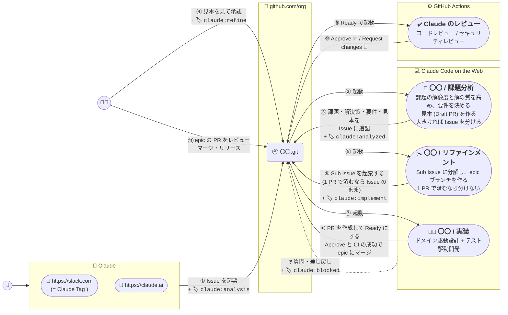
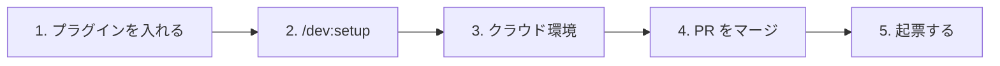
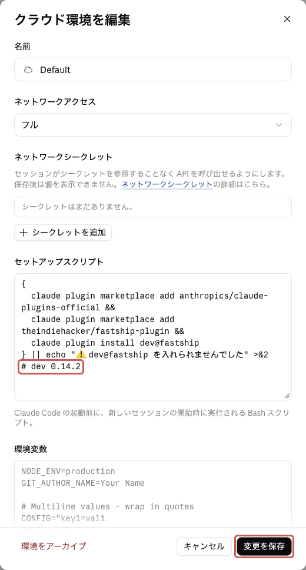
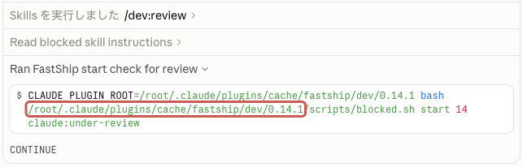
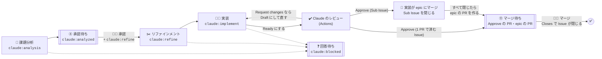
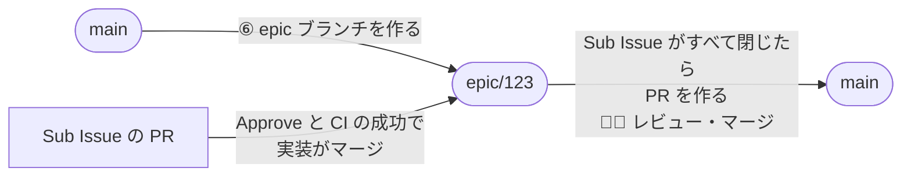

# ➕ FastShip プラグイン

FastShip プラグインは [Claude Code on the Web](https://claude.ai/code) と [スケジュール済みタスク](https://claude.ai/code/routines)、GitHub Actions を使って、要件整理から開発、レビューまで自動化する Claude プラグインです。開発したアプリは [**fastship.jp**](https://fastship.jp) で公開できます。

 - [➕ **FastShip プラグイン**](https://github.com/theindiehacker/fastship-plugin) ( Claude プラグイン )
 - [📺 **FastShip App リポジトリ**](https://github.com/theindiehacker/fastship-app) ( GitHub テンプレートリポジトリ )



課題分析・リファインメント・実装は、ルーティン (claude.ai のサブスク) で動かします。PR のレビュー (⑨⑩) は、[github-workflows](https://github.com/theindiehacker/github-workflows) の Claude のレビュー (コードレビュー・セキュリティレビュー) が GitHub Actions で行います。claude[bot] として投稿するため、開発者のアカウントで作った PR にも Approve / Request changes を付けられ、マージしてよいかが PR で分かります。レビューが動いているか・止まったかは、PR の Checks に出ます。Actions の時間と、シークレットの Claude の認証情報を使います。CI (required workflow など) は push のたびに動くため、実装は CI とレビューの指摘への修正をまとめて 1 回で push します。

PR のレビューは差分しか見ないため、月 1 回、Claude がリポジトリ全体をセキュリティ監査し (これも github-workflows・GitHub Actions)、前からある問題を `security-audit` ラベルの Issue にします。誤検知や許容するリスクは「Close as not planned」で閉じると、次回から起票されません。

Sub Issue に分けた Issue は、Sub Issue の PR を epic ブランチにまとめ、開発者は最後の 1 回だけレビュー・マージします ([🌿 ブランチ](#-ブランチ))。

## 🚀 導入



**前提**: claude.ai のアカウント (Pro / Max / Team / Enterprise)、対象リポジトリに [Claude GitHub App](https://github.com/apps/claude) と、Actions のシークレット `CLAUDE_CODE_OAUTH_TOKEN` (`claude setup-token` で発行) か `ANTHROPIC_API_KEY` (org のシークレットで構いません。public リポジトリには渡さないため、レビューが動きません)、ローカルに Claude Code (claude.ai でログイン)・`gh`・`jq`

### 1. プラグインを入れる
ローカルの Claude Code で実行します。

```text
/plugin marketplace add anthropics/claude-plugins-official
/plugin marketplace add theindiehacker/fastship-plugin
/plugin install dev@fastship
/plugin install session@fastship
```

dev と session は技術スタックに依存しません ([🛫 セッション](#-セッション-session-プラグイン))。bun / Biome・uv / Ruff / Pyright で開発するなら、`/plugin install stack@fastship` も実行します ([🧰 技術スタック](#-技術スタック-stack-プラグイン))。

### 2. `/dev:setup` を実行する
対象リポジトリで `/dev:setup` を実行します (別のリポジトリなら `/dev:setup owner/repo`)。ラベル・ルーティン 1 つ・テンプレート・Claude のレビューとセキュリティ監査の呼び出し (`.github/workflows/claude.yml`) を用意し、PR を作ります。[判断待ちの一覧](#-判断待ちの一覧) のリンクも伝えます。stack を入れていれば、技術スタックも入れるか聞きます。ほかの Claude のレビューが PR で自動で動くなら、二重になるので止めるか聞きます。導入済みなら最新版に更新します ([版を上げたとき](#版を上げたとき))。

3 は API で設定できないため、setup が案内したら画面で設定します。

### 3. クラウド環境
ルーティンが動くクラウド環境に、FastShip プラグインを入れます。環境ごとに 1 回です。

1. https://claude.ai/code の入力欄の下の環境名 → **クラウド** → setup が伝える環境の ⚙️

   

2. **セットアップスクリプト** に下を貼り、**変更を保存**

   <!-- setup の 4.3 と同じ。変えるときは両方を直す -->
   ```bash
   {
     claude plugin marketplace add anthropics/claude-plugins-official &&
     claude plugin marketplace add theindiehacker/fastship-plugin &&
     claude plugin install dev@fastship &&
     claude plugin install session@fastship
   } || echo "⚠️ dev@fastship・session@fastship を入れられませんでした" >&2
   ```

   

   setup で技術スタックを入れたなら、次の行も足します。stack は dev と一緒には入りません (session は stack の依存として入ります)。

   ```bash
   claude plugin install stack@fastship || echo "⚠️ stack@fastship を入れられませんでした" >&2
   ```

### 4. PR をマージする
setup が作った PR をマージします。マージするまで、PR のレビューは動きません。

### 5. 起票する
GitHub の UI で **New issue** → **🚀 バックログ** を選び、背景と参考資料を書いて起票します。`claude:analysis` が自動で付き、③ 課題分析が始まります。

 - 書き込み権限 (Triage 以上) の無いメンバーが起票すると、ラベルが付かないことがあります (GitHub Docs に記載が無く、[Community の報告](https://github.com/orgs/community/discussions/22510) があります)。付いていなければ、権限のある人が `claude:analysis` を付けてください。

チャットで起票したい人は、`/dev:issue` も使えます (任意)。claude.ai のチャットで `/dev:issue [owner/repo] {やりたいこと}` を実行すると、背景と参考資料を聞かれ、`claude:analysis` 付きで起票されます。使う前に、メンバーそれぞれが 1 回だけ設定します。

1. https://claude.ai/customize/plugins で **追加** → **マーケットプレイスを追加** を押し、`theindiehacker/fastship-plugin` を入れる

   

2. `dev` と、依存の `security-guidance` を有効にする (一覧に無ければ `anthropics/claude-plugins-official` も追加する)
3. **コネクタ** で GitHub を有効にし、起票先のリポジトリが見えるようにする

Claude Code からも `/dev:issue` で起票できます。Slack (Claude Tag) からは使えません (org のプラグインしか使えず、org の GitHub 同期は private リポジトリしか受け付けないため)。

### 版を上げたとき
その版の節 (`0.15.0 に上げたとき` など) があれば、その手順を行います。節の無い版では、何もしなくて構いません。

#### クラウド環境を作り直す
版の節に書いてあるときだけ行います。クラウド環境は Setup script の結果を約 7 日使い回すため、ほかの版は 7 日以内に入れ替わります。Setup script を変えると、次のセッションで作り直されます。

1. [3. クラウド環境](#3-クラウド環境) の 1 と同じく、環境の ⚙️ を開く
2. **セットアップスクリプト** の末尾に `# dev <版>` を足し (あれば版を書き換え)、**変更を保存**。版は [plugin.json](plugins/dev/.claude-plugin/plugin.json) の `version` です。session・stack だけ上がったときは `# session <版>`・`# stack <版>` を足します

   

3. 次にルーティンが動いたら、https://claude.ai/code/routines の `{リポジトリ名} / FastShip` の **履歴** から、そのセッションを開く。`blocked.sh start` を実行した行を開き、パス (`.../fastship/dev/<版>`) が新しい版か確かめる

   

### 0.21.0 に上げたとき
UI コンポーネントを shadcn/ui に揃えるため、dev に shadcn/ui の MCP サーバーを入れました ([🎨 UI](#-ui-shadcnui))。

1. ローカルで `claude plugin update dev@fastship` (stack を入れていれば `stack@fastship` も) を実行し、Claude Code を開き直して、`/mcp` で `plugin:dev:shadcn` が connected か確かめます。MCP は `npx` で動くため、Node.js が要ります
2. stack を入れているリポジトリでは、`/dev:setup` を実行し直し、作った PR をマージします。`components.json` の無い React のパッケージに、shadcn/ui を入れます

### 0.20.0 に上げたとき
技術スタックによらない処理を、新しい [session プラグイン](#-セッション-session-プラグイン) にまとめました。Web のセッションの準備 (ツール・依存・Docker の起動) と、作業を終える前の gitleaks・trivy・semgrep の検査です。stack 0.1 の SessionStart (ツール・依存の導入) は session に移り、stack 0.2.0 は session に依存します。Web のセッション開始で通信が止まっても、待ち続けずにやり直します。

1. ローカルで stack を入れているなら、`/plugin install session@fastship` を実行します。stack を 0.2.0 に更新しても session は入らず、依存が足りないエラーになります
2. `/dev:setup` を実行し直し、作った PR をマージします。`.claude/settings.json` の `enabledPlugins` に `"session@fastship": true` を、`mise.toml` に gitleaks・trivy・uv (session の検査が使う) を足します
3. リポジトリに同じことをする hook (compose の起動、gitleaks・trivy・semgrep の検査、mise・依存の導入) があれば消します。両方あると、同じ処理が 2 回、同時に動きます
4. [3. クラウド環境](#3-クラウド環境) のとおり、Setup script に `claude plugin install session@fastship` を足し、[クラウド環境を作り直します](#クラウド環境を作り直す) (`# dev 0.20.0`)

### 0.19.0 に上げたとき
月 1 回、Claude がリポジトリ全体をセキュリティ監査し、前からある問題を `security-audit` ラベルの Issue にするようにしました (github-workflows の v2.3.0 以降)。

1. `/dev:setup` を実行し直し、作った PR をマージします。`.github/workflows/claude.yml` に `schedule`・`workflow_dispatch` と `security-audit` job を足します。`claude.yml` を変えると org の必須の zizmor が `issue_comment` の行を見るため、`.github/zizmor.yml` の除外の行がずれていれば直します (このファイルの変更にはセキュリティチームの承認が要ります)
2. マージ後、Actions → **🧠 Claude** → **Run workflow** で一度動かし、Issue ができるか (指摘が無ければ「監査の指摘: 0 件」で終わります) を確かめます

### 0.18.0 に上げたとき
PR のレビューを、ルーティン (`/dev:review`) から Actions の Claude のレビュー (github-workflows) に移しました。claude[bot] が Approve / Request changes を付けるので、マージしてよいかが PR で分かります。レビューが動いているか・止まったかは、PR の Checks に出ます。`/dev:review` と `claude:under-review` はやめました。

1. github-workflows の v2.2.0 (セキュリティレビューを PR のイベントで動かせる版) がリリースされてから、`/dev:setup` を実行し直し、作った PR をマージします。`.github/workflows/claude.yml` が PR を Ready にしたときにレビューするようにし、ルーティンのプロンプトからレビューを外します。`claude.yml` の行がずれるため、`.github/zizmor.yml` の除外も直します。このファイルの変更にはセキュリティチームの承認が要ります
2. [クラウド環境を作り直します](#クラウド環境を作り直す)。古い版の実装は `claude:under-review` が外れるのを待ち、claude[bot] の Approve ではマージしないためです
3. `⑪ マージ待ち` と `⏳ 進行中` のブックマークを、setup が伝えるリンクに貼り替えます

進行中の PR は、次のようにするとレビューを受けます。

1. PR が epic ブランチに向いていて、その epic ブランチを上の 1 の PR のマージより前に切ったなら、デフォルトブランチを epic ブランチに取り込みます (`epic.sh sync <親 Issue の番号>`、下)。新しい `claude.yml` が無い epic ブランチに向けた PR では、Ready にしてもレビューが動きません。PR のワークフローは、ベースと PR のブランチを合わせたもので動くためです
2. 1 で取り込んだら、PR の **Update branch** で、epic ブランチを PR のブランチに取り込みます。epic ブランチを動かしただけでは、PR は古いベースのままです
3. `claude:under-review` を外し、Draft にしてから Ready にします
4. 古い版の実装のセッションが PR を購読したまま残っていると、指摘には対応しますが、Approve が付いても epic ブランチにマージしません。Approve と CI がそろったら、`epic.sh merge <PR の番号>` でマージし、Sub Issue を閉じます (下)。コンフリクトと出たら、PR に `claude:implement` を付けると、実装が解消します

```bash
# 対象リポジトリの作業ツリーで実行する。ローカルの dev を 0.18.0 に上げてから (claude plugin update dev@fastship)
bash ~/.claude/plugins/cache/fastship/dev/0.18.0/scripts/epic.sh sync <親 Issue の番号>
bash ~/.claude/plugins/cache/fastship/dev/0.18.0/scripts/epic.sh merge <PR の番号>
```

ルーティンのトリガーに残った `claude:under-review` と、ラベル `claude:under-review` は、残しても害はありません。要らなければ消してください。

### 0.17.0 に上げたとき
課題分析が見本 (モック画面・Mermaid・定義とスタブ) を Draft PR で作り、④ では見本を見て承認するようにしました ([👀 見本](#-見本))。

1. `/dev:setup` を実行し直します。Issue テンプレート (`backlog.md` に 見本 の欄を足しました)、Sub Issue と PR のテンプレートを更新します

進行中の Issue は、そのままで構いません。見本の無い Issue は、今までどおり進みます。

### 0.16.0 に上げたとき
Sub Issue の PR を epic ブランチにまとめ、開発者のレビュー・マージを最後の 1 回にしました ([🌿 ブランチ](#-ブランチ))。課題分析は、成功指標ではなく機能要件・非機能要件を書き、大きい Issue を分けるようにしました。

1. `/dev:setup` を実行し直します。Issue テンプレート (`backlog.md`) を更新し、epic ブランチに向けた PR で CI が動くかを確かめます
2. `⑪ マージ待ち` のブックマークを、setup が伝えるリンクに貼り替えます (`base:` を足しました)

進行中の Issue は、そのままで構いません。前の版で Sub Issue に分けた Issue は、今までどおり Sub Issue の PR をデフォルトブランチに向けます。

### 0.15.0 に上げたとき
FastShip プロジェクト (GitHub Project) をやめ、判断待ちはリポジトリの Issue 一覧で見るようにしました。Auto-add の設定も要らなくなりました。

導入済みのリポジトリでは、[📋 判断待ちの一覧](#-判断待ちの一覧) の 4 つのリンクをブックマークしてください (`/dev:setup` を実行し直しても出ます)。FastShip プロジェクトと Auto-add のワークフローは、残しても害はありません。要らなければ消してください。

## 🧰 スキル

| スキル | 使う人・場面 | すること |
|:--|:--|:--|
| `/dev:setup [owner/repo]` | 🧑‍💻 開発者 (導入・更新) | ラベル・ルーティン・テンプレート・Claude のレビューの呼び出しを導入し、PR を作る。判断待ちの一覧のリンクを伝える |
| `/dev:issue [owner/repo] {内容}` | 🧑 誰でも (① 起票) | 背景と参考資料を聞き、`claude:analysis` を付けて起票する。目的が複数あれば分けて起票する |
| `/dev:analysis {Issue}` | ルーティン (③ 課題分析) | 課題・解決策・要件 (機能要件・非機能要件) を書き、見本の Draft PR を作って、`claude:analyzed` を付ける。大きければ Issue を分ける |
| `/dev:refine {Issue}` | ルーティン (⑤⑥ リファインメント) | epic ブランチを作り、1 PR で終わる Sub Issue に分解して `claude:implement` を付ける。Sub Issue がすべて閉じると、epic ブランチの PR を作る。1 PR で済むなら分けず、Issue に完了条件を書き足して `claude:implement` を付ける |
| `/dev:implement {Sub Issue / Issue / PR}` | ルーティン (⑦⑧ 実装) | ドメイン駆動設計 + テスト駆動開発で実装し、Draft の PR を作る。Ready にして Claude のレビューに回し、指摘に対応する。epic ブランチに向けた PR は、Approve と CI の成功でマージする |
| `/dev:blocked` | ルーティン (課題分析・リファインメント・実装) | 多重起動を防ぎ、判断できないときは質問して `claude:blocked` を付ける |
| `/dev:push-pr` | 🧑‍💻 開発者 / ルーティン (⑦⑧ 実装) | PR テンプレートに沿って PR を作成・更新する |

`/dev:implement` は、リポジトリの検査 (`CLAUDE.md`・CI に書かれたテスト・lint・型チェック) を自分で実行してから PR を作ります。技術スタックの hook (stack プラグイン) は要りません。

## 🎨 UI (shadcn/ui)
画面の UI コンポーネントは、どのリポジトリでも shadcn/ui で作ります (課題分析の見本・実装)。自作や、別の UI ライブラリは足しません。

dev は [shadcn/ui の MCP サーバー](https://ui.shadcn.com/docs/mcp) (`plugins/dev/.mcp.json`) を配ります。Claude はレジストリのコンポーネントを探し、使い方の例を見て、CLI で追加します。

 - `npx` で動くため、Node.js が要ります。claude.ai のチャット (`/dev:issue`) では動きません
 - `components.json` が無いパッケージには、実装が `shadcn init` で入れます。別の UI ライブラリを使うパッケージでは混ぜず、`claude:blocked` で聞きます

## 🏷️ ラベル

| ラベル | 付ける人 | 意味 |
|:--|:--|:--|
| `claude:analysis` | 🧠 Claude | 課題分析を始める |
| `claude:analyzed` | 🧠 Claude | 課題分析が終わり、承認を待っている (ルーティンは起動しない) |
| `claude:refine` | 🧑‍💻 開発者 | 課題分析の結果を承認し、リファインメントを始める |
| `claude:implement` | 🧠 Claude | Sub Issue (1 PR で済むときは Issue) の実装を始める |
| `claude:blocked` | 🧠 Claude | 人間の回答を待っている |

PR のレビューはラベルを使いません。PR を Ready にすると動き、結果はコードレビューの Approve / Request changes で示します ([📋 判断待ちの一覧](#-判断待ちの一覧))。

## 📋 判断待ちの一覧

開発者は、リポジトリの Issue 一覧を下の 4 つのクエリで絞れば、次に判断することが分かります。クエリはラベルと PR の Draft / Ready で絞り込んでいます。二重枠が、一覧に載る (開発者の番の) 状態です。Claude の番の状態は `⏳ 進行中` に載り、止まっていないかを確かめられます。



| 一覧 | クエリ | 判断すること |
|:--|:--|:--|
| ④ 承認待ち | `is:issue is:open label:"claude:analyzed"` | 見本の PR と要件を見て、承認か差し戻しか |
| ❓ 回答待ち | `is:open label:"claude:blocked"` | Claude の質問への回答 |
| ⑪ マージ待ち | `is:pr is:open draft:false base:<デフォルトブランチ> -label:"claude:blocked" (review:approved OR head:epic/)` | マージ・リリースするか |
| ⏳ 進行中 | `is:open label:"claude:analysis","claude:refine","claude:implement" -label:"claude:blocked"` | 止まっていないか ([🛟 ルーティンの前提](#-ルーティンの前提)) |

 - リンクは `https://github.com/{owner/repo}/issues?q=<クエリ>` です。リポジトリの Issue 一覧は、Issue と PR を一緒に出します。`/dev:setup` が対象リポジトリのリンクを伝えるので、ブックマークしてください。
 - リポジトリが複数あるときは、リポジトリごとのリンクを使います。`⑪ マージ待ち` には、コードレビューが Approve した PR と、epic ブランチの PR (Claude のレビューの結果に関わらず、開発者がレビューする) が載ります。FastShip を通っていない PR も、Approve されれば載ります。epic ブランチに向けた Sub Issue の PR は、実装がマージするため載りません (`base:`)。

PR は、実装・修正の間だけ Draft にします。

| PR | 状態 | 切り替える所 |
|:--|:--|:--|
| Draft | 🧠 実装・修正中 | 実装は Draft で PR を作る。Request changes や CI の失敗を直すときと、止めた実装を再開するときに Draft にする |
| Ready | 🧠 レビュー中 | 実装が push を終えたら、Ready にする。Claude のレビューが動き、PR の Checks に出る |
| Ready + `claude:blocked` | 🧑‍💻 回答待ち | 実装が人に返すとき。Draft なら Ready にする (レビューは動かない) |
| Ready + Approve | 🧑‍💻 マージ待ち | コードレビューが Approve したら。epic ブランチに向けた PR は、CI が通ると実装がマージする |

 - Draft の PR にラベルを付けても、ルーティンは起動しません。止めた実装は、Ready の PR に `claude:implement` を付けて再開します。
 - Claude のレビューは、PR を作ったとき (Draft なら Ready にしたとき) に動きます。ベースとコンフリクトしている PR では動きません (GitHub の仕様)。
 - レビューの間も Ready なので、マージボタンは押せます。`⑪ マージ待ち` には Approve の後に出るため、一覧から Approve の前にマージすることはありません。CODEOWNERS があると、Ready にするたびにレビューの依頼が届きます。
 - Issue の進み具合は、PR の Draft ではなくラベル (`claude:implement` など) で見ます。Issue の検索では、Issue をつながった PR の Draft で絞れないためです。

 - `claude:analyzed` は、課題分析・リファインメントが Issue の状態から決めて付け外しします (`scripts/waiting.sh`)。手で付け外ししても、次にそれらが動いたときに状態に合わせ直されます。
   - 課題分析が、最後の承認 (`claude:refine` を付けた) より後に終わったときに付きます
   - 進行中ラベル (`claude:analysis` / `claude:refine` など) か `claude:blocked` が付いている間は付きません
 - Sub Issue がすべて閉じて 1 つ以上が完了すると、リファインメントが epic ブランチの PR を作ります。親 Issue は、その PR のマージ (`Closes`) で閉じます。すべて見送りなら、作らずに残します。1 PR で済む Issue は、PR の `Closes` で閉じます。

## 🧑‍💻 人間が判断すること

1. **④ 承認** (`④ 承認待ち`): 課題分析で追記された課題・解決策・要件を確認し、解く価値があるかを判断します。作るものが合っているかは、見本の PR を見て判断します ([👀 見本](#-見本))。大きい Issue は課題分析が分けるので、分けた Issue もそれぞれ承認します。優先順位の高い Issue から `claude:refine` を付けます。方向がずれている場合は、Issue か見本の PR にコメントして、Issue に `claude:analysis` を付け直します。見送るときは、Issue を閉じます。
2. **⑪ マージ・リリース** (`⑪ マージ待ち`): コードレビューが Approve し、CI が通った PR を確認し、マージ・リリースします。CI の結果は PR で確かめてください。完了条件を満たすかは、PR の ✔️ 動作確認 で確かめます (実装が、完了条件ごとにテストか動作確認の結果を書きます)。Sub Issue に分けた Issue は、epic ブランチの PR で全体を確かめます。✔️ 動作確認 に、要件ごとに確かめた Sub Issue の PR が書いてあります。epic ブランチの PR にも Claude のレビューが付きますが、Request changes でも実装は動かないので、直すかは開発者が決めます。Approve の後に自分で push したとき (コンフリクトの解消など) は、PR に `/code-review` とコメントすると再レビューを受けられます。Approve の後に、実装が小さな指摘だけを直して push することがあります。再レビューはせず、直した commit を指摘への返信に書きます (epic ブランチに向けた Sub Issue の PR では直さず、返信だけにします)。

## 👀 見本
文章の要件は分量が多く、読み手によって解釈が分かれます。そこで課題分析は、画面・API / MCP・インフラ構成が変わる Issue で見本を作り、Draft PR にします。開発者は ④ で見本を見て承認します。

| 変わるもの | 見本 |
|:--|:--|
| 画面 | 固定のデータで表示するモック画面と、場面ごとのスクリーンショット |
| API / MCP | 定義 (OpenAPI / ツールの定義)、入出力の例を返すスタブ、シーケンス図 (Mermaid) |
| インフラ | 構成図 (Mermaid) と、追加・変更・削除するリソースの一覧 |

 - 見本の PR はマージしません。承認した版は、Issue の 見本 に commit の sha で残ります。リファインメントが完了条件に入れてから、PR を閉じます。
 - 実装は見本どおりに作り (見本のコードを出発点にしてよい)、見本と見比べた結果を PR の ✔️ 動作確認 に書きます。
 - 直してほしいときは、見本の PR に行コメントするか Issue にコメントし、Issue に `claude:analysis` を付け直します。
 - 見本の PR は Draft なので、`⑪ マージ待ち` には載りません。CI は動きますが、マージしないので、失敗しても直しません。

## 🌿 ブランチ
Sub Issue に分けた Issue は、epic ブランチ (`epic/<親 Issue の番号>`) にまとめてから、デフォルトブランチに入れます。



| Issue | PR のベース | マージする人 |
|:--|:--|:--|
| Sub Issue に分けた Issue | `epic/<親 Issue の番号>` | Sub Issue の PR は 🧠 実装。epic ブランチの PR は 🧑‍💻 開発者 |
| 1 PR で済む Issue | デフォルトブランチ | 🧑‍💻 開発者 |

 - 実装は、Sub Issue の PR をマージすると、Sub Issue を閉じます。`Closes` はデフォルトブランチへのマージでしか閉じないためです。手で epic ブランチにマージしたときは、Sub Issue も閉じてください。後続の Sub Issue の実装が始まります。
 - Approve で CI も通ったのにマージされないときは、PR に `claude:implement` を付けてください。実装が再開し、再レビューの後にマージします。
 - リファインメントは、Sub Issue が閉じるたびに、デフォルトブランチを epic ブランチに取り込みます。コンフリクトして取り込めないときは、epic ブランチの PR で開発者が解消します。
 - epic ブランチに向けた PR でも CI が動くようにしてください (`/dev:setup` が確かめます)。動かないと、実装はマージせずに人間に返します。
 - Sub Issue の PR に開発者が Request changes を付けると、解消する (Approve か Dismiss) までマージしません。

## ❓ 質問・差し戻し

Claude だけで判断できないことがあると、ルーティンは処理を止めて人間に返します。手順は `/dev:blocked` スキルにまとめています。

1. Claude が Issue / PR に質問をコメントし、進行中のラベル (`claude:analysis` / `claude:refine` / `claude:implement`) を外して `claude:blocked` を付けます。
2. 開発者は `❓ 回答待ち` の一覧で Issue / PR を確認し、コメントで回答します。
3. 開発者が `claude:blocked` を外して元のラベルを、止まった Issue / PR に付け直すと、処理が再開します。再開したセッションは、前回の質問と回答を読んでから続けます。

同じ Issue / PR で動くセッションは 1 つだけです。後から起動したセッションは何もせずに終わります。進行中のラベルが付いたまま 10 分以上進まないときは、ルーティンが動かなかったか、セッションが途中で止まっています (`⏳ 進行中` に残ります)。そのラベルを外して付け直すと、やり直します。

Claude のレビューの指摘 (Request changes など) は、実装のセッションが対応します。Claude だけで判断できない指摘は、同じ手順で `claude:blocked` を付けて人間に返します。人が作った PR も、作ったとき (Draft なら Ready にしたとき) にレビューされます。直した後の再レビューは、PR に `/code-review` とコメントして頼みます。

## 🛟 ルーティンの前提

ルーティンは、気づかないうちに止まることがあります。

 - ルーティンは、作った人の claude.ai アカウントに属し、チームでは共有されません。作った人の利用枠を使い、その人が抜けると止まります。そのときは、別の人が `/dev:setup` を実行し直して作り直してください。
 - FastShip が使う `issues.labeled`・`issues.closed` のトリガーは、[ルーティンのドキュメント](https://code.claude.com/docs/en/routines) にありません (載っている GitHub イベントは Pull request と Release だけです)。
 - GitHub イベントは、ルーティンごと・アカウントごとの毎時の上限を超えると捨てられます。上限の数値は公開されていません。ルーティンは 1 つなので、課題分析・リファインメント・実装で 1 つの上限を分け合います。

どの場合も、進行中のラベル (`claude:analysis` / `claude:refine` / `claude:implement`) が付いたまま動きません。`⏳ 進行中` の一覧をときどき見て、10 分以上進まないものはラベルを外して付け直してください。

Claude のレビューはルーティンではなく Actions で動くので、止まったかは PR の Checks で分かります。失敗したら、Actions の **Re-run jobs** で再実行してください。

Sub Issue は、PR がマージされるまで `claude:implement` が付いたままなので、PR がマージを待つ間も `⏳ 進行中` に載ります。止まっているかは、PR を見て確かめてください。PR が Draft のまま 10 分以上進まないときは、Sub Issue の `claude:implement` を外して付け直すと、実装が PR を Ready にして引き継ぎます。

## 🛫 セッション (session プラグイン)

`session` は、技術スタックによらず、どのリポジトリにも入れるプラグインです。セッションの始めに環境を整え、終わりに安全を確かめます。

| 配るもの | 内容 |
|:--|:--|
| 🚀 SessionStart | Claude Code on the web で、mise のツールと、lock ファイル (`bun.lock`・`uv.lock`) の依存を入れ、lefthook の Git フック (pre-commit) を設定する。その後、compose ファイルがあれば、Docker を起動してサービスを立ち上げる (`docker compose up --build -d --wait`)。通信が止まったら打ち切ってやり直し、hook の上限 (600 秒) より前に終える。セッションの開始と再開でだけ動く (compact・clear では動かない) |
| ✔️ Stop | 変更が gitleaks (シークレット)・trivy (依存の脆弱性・IaC の設定ミス)・semgrep (コードの脆弱性) を通るまで、作業を続けさせる。デフォルトブランチから分かれた後の変更 (セッション中にコミット・push したものを含む) を確かめる。trivy は変更した lock ファイルと IaC (Dockerfile・`*.tf`・compose ファイル) だけを確かめる |

 - SessionStart は Web でだけ動きます。プラグインの hook は開いたどのリポジトリでも動くため、ローカルでは信頼していないリポジトリのイメージをビルド・実行しないよう、compose を起動しません
 - hook は、道具と設定 (`mise.toml`・lock ファイル・compose ファイルなど) があるリポジトリでだけ動きます。検査の道具 (gitleaks・trivy・uv) は、`/dev:setup` が `mise.toml` に入れます
 - compose のファイルは、セッションの開始時に読んだもので `COMPOSE_FILE` を決めます。セッションの途中で build のあるサービスの名前を変えたり消したりしたら、セッションを開き直してください
 - Web のプロキシは TLS を検査するため、イメージのビルドに、プロキシの CA を build の secret `ca-certificates` で渡します。Dockerfile では `RUN --mount=type=secret,id=ca-certificates,target=/etc/ssl/certs/ca-certificates.crt uv sync` のように受け取ります。Web では `docker compose` をリポジトリのルートで実行してください。サブディレクトリからだと、ビルドが CA の読み込みの許可待ちで止まります

## 🧰 技術スタック (stack プラグイン)

`stack` は、使うリポジトリだけが入れるプラグインです。dev とは別に入れます (session は依存として入ります)。bun / Biome・uv / Ruff / Pyright・shadcn/ui・Tailwind CSS で開発するリポジトリに、次を配ります。

| 配るもの | 内容 |
|:--|:--|
| 🚫 PreToolUse | bun・uv のリポジトリで npm・pip などを止め、bun・uv を使わせる |
| ✏️ PostToolUse | Claude が編集したファイルを Biome・Ruff で整形する |
| ✔️ Stop | 変更したファイルが Biome・tsc・Ruff・Pyright を通り、knip (使っていないコード・依存)・deptry (Python の依存の過不足)・lint-imports (import の規約) の違反が無くなるまで、作業を続けさせる。knip・deptry・lint-imports はプロジェクト全体を確かめる |
| 🎨 `/stack:ui` | shadcn/ui・Tailwind CSS の書き方 (shadcn の MCP で探して例を見て、CLI で追加する) |
| 📚 依存 | session (Web で、hook が使う依存を入れる)・Context7 (版に合ったドキュメント)・pyright-lsp (編集した直後の型エラー) |

1. ローカルで `/plugin install stack@fastship` を実行してから、`/dev:setup` で技術スタックを入れると答えます。setup が `/stack:setup` で道具と設定を入れ (React のパッケージには shadcn/ui も入れます)、リポジトリの `.claude/settings.json` で stack を有効にします。
2. クラウド環境のセットアップスクリプトに、`claude plugin install stack@fastship` の行を足します ([3. クラウド環境](#3-クラウド環境))。

hook は、道具と設定 (`node_modules` の Biome・knip、`.venv` の Ruff・deptry・lint-imports と `[tool.importlinter]` など) があるリポジトリでだけ動きます。ローカルで pyright-lsp を使うには、`pyright-langserver` を PATH に入れてください (例: `uv tool install pyright`)。
