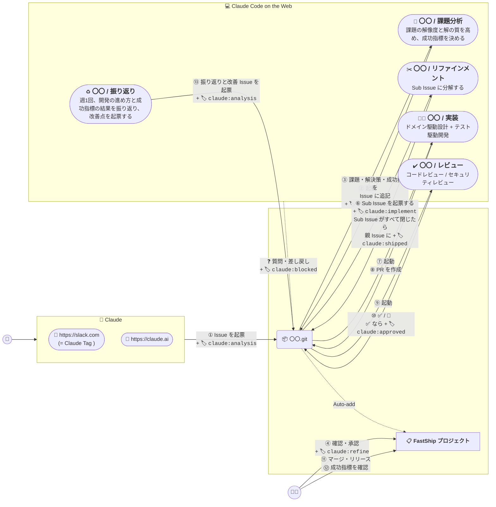
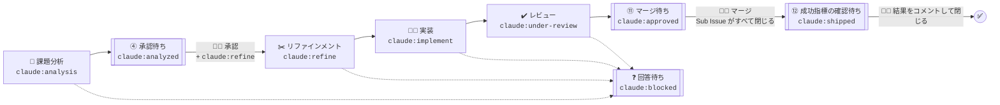

# ➕ FastShip プラグイン

FastShip プラグインは [Claude Code on the Web](https://claude.ai/code) と [スケジュール済みタスク](https://claude.ai/code/routines) を使って、要件整理から開発、レビューまで自動化する Claude プラグインです。開発したアプリは [**fastship.jp**](https://fastship.jp) で公開できます。

 - [📋 **FastShip プロジェクト**](https://github.com/orgs/theindiehacker/projects/6) ( GitHub Project テンプレート )
 - [➕ **FastShip プラグイン**](https://github.com/theindiehacker/fastship-plugin) ( Claude プラグイン )
 - [📺 **FastShip App リポジトリ**](https://github.com/theindiehacker/fastship-app) ( GitHub テンプレートリポジトリ )



## 🏷️ ラベル

| ラベル | 付ける人 | 意味 |
|:--|:--|:--|
| `claude:analysis` | 🧠 Claude | 課題分析を始める |
| `claude:analyzed` | 🧠 Claude | 課題分析が終わり、承認を待っている (ルーティンは起動しない) |
| `claude:refine` | 🧑‍💻 開発者 | 課題分析の結果を承認し、リファインメントを始める |
| `claude:implement` | 🧠 Claude | Sub Issue の実装を始める |
| `claude:under-review` | 🧠 Claude | PR のレビューを始める |
| `claude:approved` | 🧠 Claude | レビューが ✅ になった (ルーティンは起動しない) |
| `claude:shipped` | 🧠 Claude | Sub Issue がすべて閉じ、成功指標の確認を待っている (ルーティンは起動しない) |
| `claude:blocked` | 🧠 Claude | 人間の回答を待っている |
| `claude:retrospective` | 🧠 Claude | 振り返りの結果 (ルーティンは起動しない) |

## 📋 FastShip プロジェクト

開発者は FastShip プロジェクト (GitHub Project) のビューを見れば、次に判断することが分かります。ビューはラベルで絞り込んでいます。二重枠が、ビューに載る (開発者の番の) 状態です。



| ビュー | 載るもの (フィルタ) | 判断すること |
|:--|:--|:--|
| ④ 承認待ち | `is:issue is:open label:"claude:analyzed"` | 課題・解決策・成功指標を読み、承認か差し戻しか |
| ❓ 回答待ち | `is:open label:"claude:blocked"` | Claude の質問への回答 |
| ⑪ マージ待ち | `is:pr is:open label:"claude:approved" -label:"claude:blocked" -label:"claude:under-review"` | マージ・リリースするか |
| ⑫ 成功指標の確認待ち | `is:issue is:open label:"claude:shipped"` | 成功指標を満たしたか |

 - プロジェクトの Status と Board は、工程と連動しません。GitHub の Status はラベルの変化で変えられないため、ラベルを正にしています。
 - テンプレートは https://github.com/orgs/theindiehacker/projects/6 です。`/dev:setup` が、テンプレートをコピーして対象リポジトリにつなぎます (setup の 4.4)。

### setup を使わずにつなぐ
1. テンプレートを開き、メニューの「Make a copy」で owner にコピーします。タイトルは `FastShip プロジェクト` にします。ビューと組み込みのワークフローは引き継がれます。
2. 対象リポジトリの Projects タブで「Link a project」を押し、1 のプロジェクトをリンクします。
3. プロジェクトの Workflows で「Auto-add to project」を開き、Repository に対象リポジトリ、Filters に下の値を入れて「Save and turn on workflow」を押します。Auto-add はリポジトリごとに 1 つ要り、プランごとに数の上限があります (Free 1 / Pro・Team 5 / Enterprise 20)。

   ```text
   is:issue,pr label:"claude:analysis","claude:analyzed","claude:refine","claude:implement","claude:under-review","claude:approved","claude:blocked","claude:shipped"
   ```

4. Auto-add は有効にする前からある Issue / PR を入れないため、claude ラベルが付いた open の Issue / PR を、プロジェクトの「Add item」で追加します。

### 0.12.0 に上げたとき
 - `/dev:setup` を実行し直し、ラベルを作ってプロジェクトにつないでください。
 - 0.12.0 より前に課題分析が終わり、承認を待っている Issue には、`claude:analyzed` を手で付けてください。成功指標の確認を待っている Issue には、週1回の振り返りが `claude:shipped` を付けます。

## 🧑‍💻 人間が判断すること

1. **④ 承認** (`④ 承認待ち`): 課題分析で追記された課題・解決策・成功指標を確認し、優先順位の高い Issue から `claude:refine` を付けます。方向がずれている場合は、Issue にコメントして `claude:analysis` を付け直します。見送るときは、Issue を閉じるか `claude:analyzed` を外します。
2. **⑪ マージ・リリース** (`⑪ マージ待ち`): `claude:approved` が付き (レビューが ✅)、CI が通った PR を確認し、マージ・リリースします。CI の結果はビューに出ないため、PR で確かめてください。✅ の後に自分で push したとき (コンフリクトの解消など) は、`claude:approved` を外して `claude:under-review` を付け、再レビューを受けてください。
3. **⑫ 成功指標の確認** (`⑫ 成功指標の確認待ち`): Sub Issue がすべて閉じると、親 Issue に `claude:shipped` が付きます。リリース後に成功指標を満たしたかを Issue にコメントし、Issue を閉じます。結果は週1回の振り返りで使います。閉じるまでは、振り返りの確認待ちに載ります。

## ❓ 質問・差し戻し

Claude だけで判断できないことがあると、ルーティンは処理を止めて人間に返します。手順は `/dev:blocked` スキルにまとめています。

1. Claude が Issue / PR に質問をコメントし、進行中のラベル (`claude:analysis` / `claude:refine` / `claude:implement` / `claude:under-review`) を外して `claude:blocked` を付けます。
2. 開発者は FastShip プロジェクトの `❓ 回答待ち` で Issue / PR を確認し、コメントで回答します。
3. 開発者が `claude:blocked` を外して元のラベルを、止まった Issue / PR に付け直すと、処理が再開します。再開したセッションは、前回の質問と回答を読んでから続けます。

同じ Issue / PR で動くセッションは 1 つだけです。後から起動したセッションは何もせずに終わります。

レビューの 🛑 は実装のセッションが対応します。Claude だけで判断できない指摘は、同じ手順で `claude:blocked` を付けて人間に返します。人が作った PR も、`claude:under-review` を付けるとレビューします。
