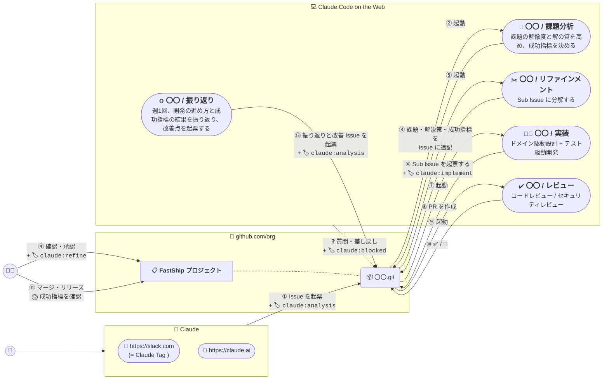

# ➕ FastShip プラグイン

FastShip プラグインは [Claude Code on the Web](https://claude.ai/code) と [スケジュール済みタスク](https://claude.ai/code/routines) を使って、要件整理から開発、レビューまで自動化する Claude プラグインです。開発したアプリは [**fastship.jp**](https://fastship.jp) で公開できます。

 - [📋 **FastShip プロジェクト**](https://github.com/orgs/theindiehacker/projects/6) ( GitHub Project )
 - [➕ **FastShip プラグイン**](https://github.com/theindiehacker/fastship-plugin) ( Claude プラグイン )
 - [📺 **FastShip App リポジトリ**](https://github.com/theindiehacker/fastship-app) ( GitHub テンプレートリポジトリ )

## 🏷️ ラベル

| ラベル | 付ける人 | 意味 |
|:--|:--|:--|
| `claude:analysis` | 🧠 Claude | 課題分析を始める |
| `claude:refine` | 🧑‍💻 開発者 | 課題分析の結果を承認し、リファインメントを始める |
| `claude:implement` | 🧠 Claude | Sub Issue の実装を始める |
| `claude:under-review` | 🧠 Claude | PR のレビューを始める |
| `claude:blocked` | 🧠 Claude | 人間の回答を待っている |
| `claude:retrospective` | 🧠 Claude | 振り返りの結果 (ルーティンは起動しない) |

## 🧑‍💻 人間が判断すること

1. **④ 承認**: 課題分析で追記された課題・解決策・成功指標を確認し、優先順位の高い Issue から `claude:refine` を付けます。方向がずれている場合は、Issue にコメントして `claude:analysis` を付け直します。
2. **⑪ マージ・リリース**: レビューが ✅ になった PR を確認し、マージ・リリースします。
3. **⑫ 成功指標の確認**: リリース後に成功指標を満たしたかを Issue にコメントします。結果は週1回の振り返りで使います。

## ❓ 質問・差し戻し

Claude だけで判断できないことがあると、ルーティンは処理を止めて人間に返します。手順は `/dev:blocked` スキルにまとめています。

1. Claude が Issue / PR に質問をコメントし、進行中のラベル (`claude:analysis` / `claude:refine` / `claude:implement` / `claude:under-review`) を外して `claude:blocked` を付けます。
2. 開発者は FastShip プロジェクトで `claude:blocked` が付いた Issue / PR を確認し、コメントで回答します。
3. 開発者が `claude:blocked` を外して元のラベルを、止まった Issue / PR に付け直すと、処理が再開します。再開したセッションは、前回の質問と回答を読んでから続けます。

同じ Issue / PR で動くセッションは 1 つだけです。後から起動したセッションは何もせずに終わります。

レビューの 🛑 は実装のセッションが対応します。Claude だけで判断できない指摘は、同じ手順で `claude:blocked` を付けて人間に返します。
