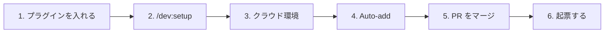
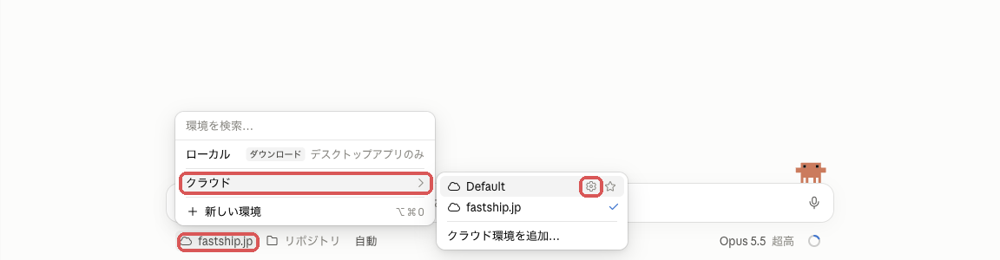
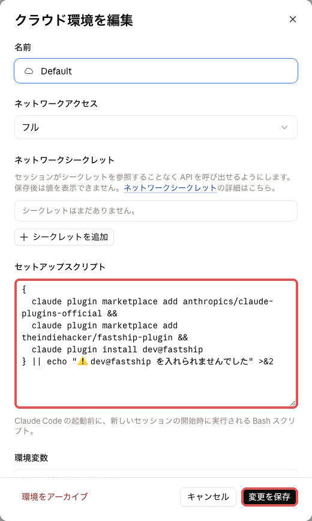
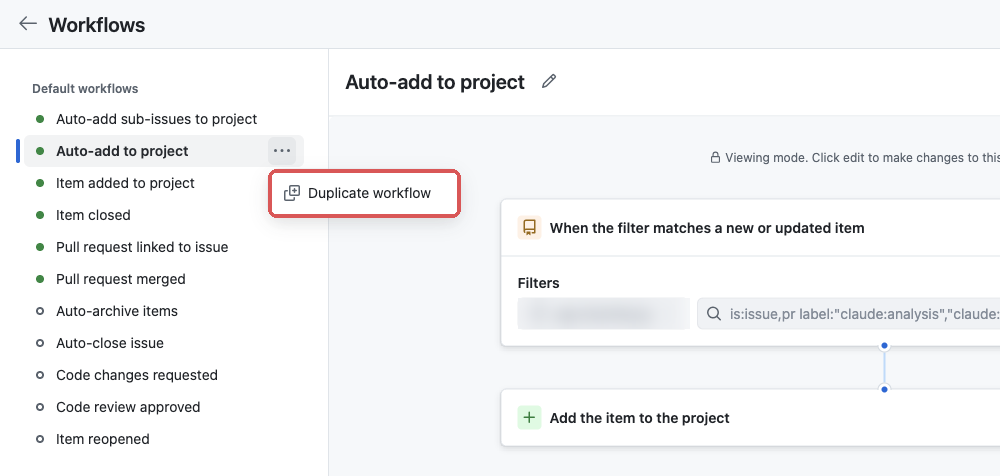
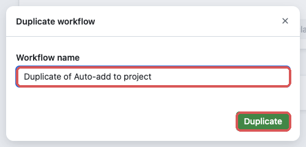
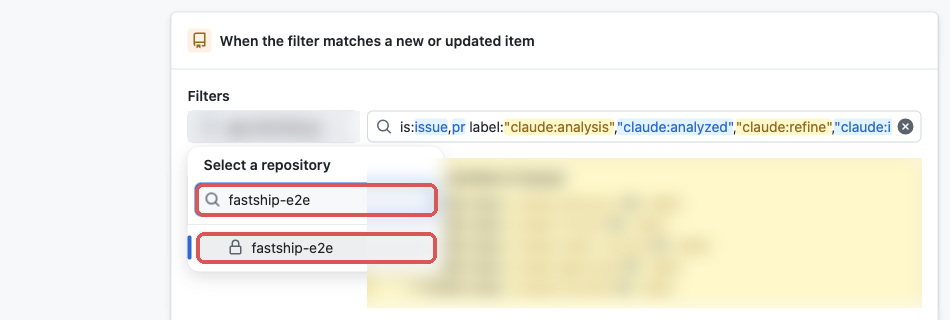
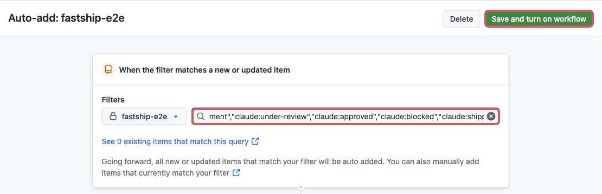
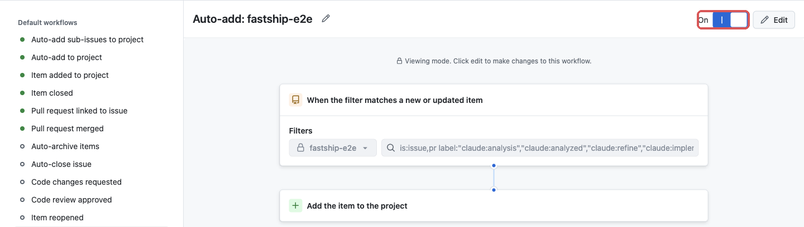
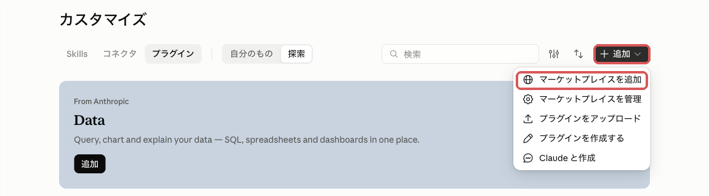
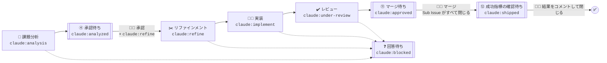

# ➕ FastShip プラグイン

FastShip プラグインは [Claude Code on the Web](https://claude.ai/code) と [スケジュール済みタスク](https://claude.ai/code/routines) を使って、要件整理から開発、レビューまで自動化する Claude プラグインです。開発したアプリは [**fastship.jp**](https://fastship.jp) で公開できます。

 - [📋 **FastShip プロジェクト**](https://github.com/orgs/theindiehacker/projects/6) ( GitHub Project テンプレート )
 - [➕ **FastShip プラグイン**](https://github.com/theindiehacker/fastship-plugin) ( Claude プラグイン )
 - [📺 **FastShip App リポジトリ**](https://github.com/theindiehacker/fastship-app) ( GitHub テンプレートリポジトリ )


## 🚀 導入



**前提**: claude.ai のアカウント (Pro / Max / Team / Enterprise)、対象リポジトリに [Claude GitHub App](https://github.com/apps/claude)、ローカルに Claude Code (claude.ai でログイン)・`gh` (`gh auth login -s project`)・`jq`

### 1. プラグインを入れる
ローカルの Claude Code で実行します。

```text
/plugin marketplace add anthropics/claude-plugins-official
/plugin marketplace add theindiehacker/fastship-plugin
/plugin install dev@fastship
```

### 2. `/dev:setup` を実行する
対象リポジトリで `/dev:setup` を実行します (別のリポジトリなら `/dev:setup owner/repo`)。ラベル・ルーティン 5 つ・テンプレート・FastShip プロジェクトを用意し、PR を作ります。導入済みなら最新版に更新します。

3 と 4 は API で設定できないため、setup が案内したら画面で設定します。

### 3. クラウド環境
ルーティンが動くクラウド環境に、FastShip プラグインを入れます。環境ごとに 1 回です。

1. https://claude.ai/code の入力欄の下の環境名 → **クラウド** → setup が伝える環境の ⚙️

   

2. **セットアップスクリプト** に下を貼り、**変更を保存**

   <!-- setup の 4.3 と同じ。変えるときは両方を直す -->
   ```bash
   {
     claude plugin marketplace add anthropics/claude-plugins-official &&
     claude plugin marketplace add theindiehacker/fastship-plugin &&
     claude plugin install dev@fastship
   } || echo "⚠️ dev@fastship を入れられませんでした" >&2
   ```

   

### 4. Auto-add
claude ラベルの付いた Issue / PR が、FastShip プロジェクトに自動で載るようにします。リポジトリごとに 1 回です。

1. setup が伝える Workflows の画面で、**Auto-add to project** の **…** → **Duplicate workflow** (プロジェクトで 1 つ目のリポジトリなら、Auto-add to project を開いて **Edit** を押し、3 へ)

   

2. 名前 (例: `Auto-add: <リポジトリ名>`) を入れて **Duplicate**

   

3. **Filters** の左のボタンで、対象リポジトリを選ぶ

   

4. 右の欄を消して下を貼り、**Save and turn on workflow**

   ```text
   is:issue,pr label:"claude:analysis","claude:analyzed","claude:refine","claude:implement","claude:under-review","claude:approved","claude:blocked","claude:shipped"
   ```

   

5. **On** になれば完了 (Auto-add の数はプランごとに上限があります。Free 1 / Pro・Team 5 / Enterprise 20)

   

### 5. PR をマージする
setup が作った PR をマージします。

### 6. 起票する
claude.ai のチャットで `/dev:issue [owner/repo] {やりたいこと}` を実行すると、背景と参考資料を聞かれ、`claude:analysis` 付きで起票されて ③ 課題分析が始まります。使う前に、メンバーそれぞれが 1 回だけ設定します。

1. https://claude.ai/customize/plugins で **追加** → **マーケットプレイスを追加** を押し、`theindiehacker/fastship-plugin` を入れる

   

2. `dev` と、依存の `security-guidance` を有効にする (一覧に無ければ `anthropics/claude-plugins-official` も追加する)
3. **コネクタ** で GitHub を有効にし、起票先のリポジトリが見えるようにする

Claude Code からも `/dev:issue` で起票できます。Slack (Claude Tag) からは使えません (org のプラグインしか使えず、org の GitHub 同期は private リポジトリしか受け付けないため)。

## 🧰 スキル

| スキル | 使う人・場面 | すること |
|:--|:--|:--|
| `/dev:setup [owner/repo]` | 🧑‍💻 開発者 (導入・更新) | ラベル・ルーティン・テンプレート・FastShip プロジェクトを導入し、PR を作る |
| `/dev:issue [owner/repo] {内容}` | 🧑 誰でも (① 起票) | 背景と参考資料を聞き、`claude:analysis` を付けて起票する |
| `/dev:analysis {Issue}` | 課題分析ルーティン (③) | 課題・解決策・成功指標を書き、`claude:analyzed` を付ける |
| `/dev:refine {Issue}` | リファインメントルーティン (⑤⑥) | 1 PR で終わる Sub Issue に分解し、`claude:implement` を付ける |
| `/dev:implement {Sub Issue / PR}` | 実装ルーティン (⑦⑧) | ドメイン駆動設計 + テスト駆動開発で実装し、PR を作って `claude:under-review` を付ける |
| `/dev:review {PR}` | レビュールーティン (⑨⑩) | コードレビューとセキュリティレビューをし、✅ なら `claude:approved` を付ける |
| `/dev:retrospective` | 振り返りルーティン (週1回) | 開発を振り返り、改善 Issue を最大 3 件起票する |
| `/dev:blocked` | 課題分析・リファインメント・実装・レビューのルーティン | 多重起動を防ぎ、判断できないときは質問して `claude:blocked` を付ける |
| `/dev:push-pr` | 🧑‍💻 開発者 / 実装ルーティン | PR テンプレートに沿って PR を作成・更新する |

このほか、クラウドセッションの開始時に、mise とツールを入れて lefthook の Git フック (pre-commit) を設定する SessionStart フックがあります (`mise.toml` があるリポジトリだけ)。

## 🏷️ ラベル

| ラベル | 付ける人 | 意味 |
|:--|:--|:--|
| `claude:analysis` | 🧠 Claude | 課題分析を始める |
| `claude:analyzed` | 🧠 Claude | 課題分析が終わり、承認を待っている (ルーティンは起動しない) |
| `claude:refine` | 🧑‍💻 開発者 | 課題分析の結果を承認し、リファインメントを始める |
| `claude:implement` | 🧠 Claude | Sub Issue の実装を始める |
| `claude:under-review` | 🧠 Claude | PR のレビューを始める |
| `claude:approved` | 🧠 Claude | レビューが ✅ になった (ルーティンは起動しない) |
| `claude:shipped` | 🧠 Claude | Sub Issue がすべて閉じ、成功指標の確認を待っている (ルーティンは起動しない) |
| `claude:blocked` | 🧠 Claude | 人間の回答を待っている |
| `claude:retrospective` | 🧠 Claude | 振り返りの結果 (ルーティンは起動しない) |

## 📋 FastShip プロジェクト

開発者は FastShip プロジェクト (GitHub Project) のビューを見れば、次に判断することが分かります。ビューはラベルで絞り込んでいます。二重枠が、ビューに載る (開発者の番の) 状態です。



| ビュー | 載るもの (フィルタ) | 判断すること |
|:--|:--|:--|
| ④ 承認待ち | `is:issue is:open label:"claude:analyzed"` | 課題・解決策・成功指標を読み、承認か差し戻しか |
| ❓ 回答待ち | `is:open label:"claude:blocked"` | Claude の質問への回答 |
| ⑪ マージ待ち | `is:pr is:open label:"claude:approved" -label:"claude:blocked" -label:"claude:under-review"` | マージ・リリースするか |
| ⑫ 成功指標の確認待ち | `is:issue is:open label:"claude:shipped"` | 成功指標を満たしたか |

 - プロジェクトの Status と Board は、工程と連動しません。GitHub の Status はラベルの変化で変えられないため、ラベルを正にしています。
 - `claude:analyzed` と `claude:shipped` は、課題分析・リファインメント・振り返りが Issue の状態から決めて付け外しします (`scripts/waiting.sh`)。手で付け外ししても、次にそれらが動いたときに状態に合わせ直されます。
   - `claude:analyzed`: 課題分析が、最後の承認 (`claude:refine` を付けた) より後に終わった
   - `claude:shipped`: 承認待ちではなく、Sub Issue がすべて閉じて 1 つ以上が完了し (すべて見送りなら付かない)、成功指標 が書いてある
   - どちらも、進行中ラベル (`claude:analysis` / `claude:refine` など) か `claude:blocked` が付いている間は付きません
 - テンプレートは https://github.com/orgs/theindiehacker/projects/6 です。`/dev:setup` が、テンプレートをコピーして対象リポジトリにつなぎます (setup の 4.4)。

### setup を使わずにつなぐ
1. owner の Projects に `FastShip プロジェクト` が無ければ、[テンプレート](https://github.com/orgs/theindiehacker/projects/6) のメニューの **Make a copy** でコピーし、タイトルを `FastShip プロジェクト` にします。あれば、上の表のビューがあるか確かめ、無いものを作ります (同じ名前でフィルタが違うビューは、作らずにフィルタを直す)。
2. 対象リポジトリの **Projects** タブ → **Link a project** で、1 のプロジェクトをリンクします。
3. [4. Auto-add](#4-auto-add) を設定します。
4. claude ラベルが付いた open の Issue / PR を、プロジェクトの **Add item** で追加します (Auto-add は、有効にする前からあるものを入れないため)。

### 0.12.0 に上げたとき
 - `/dev:setup` を実行し直し、ラベルを作ってプロジェクトにつないでください。
 - 0.12.0 より前に課題分析が終わり、承認を待っている Issue には、`claude:analyzed` を手で付けてください。成功指標の確認を待っている Issue には、週1回の振り返りが `claude:shipped` を付けます。

## 🧑‍💻 人間が判断すること

1. **④ 承認** (`④ 承認待ち`): 課題分析で追記された課題・解決策・成功指標を確認し、優先順位の高い Issue から `claude:refine` を付けます。方向がずれている場合は、Issue にコメントして `claude:analysis` を付け直します。見送るときは、Issue を閉じます。
2. **⑪ マージ・リリース** (`⑪ マージ待ち`): `claude:approved` が付き (レビューが ✅)、CI が通った PR を確認し、マージ・リリースします。CI の結果はビューに出ないため、PR で確かめてください。✅ の後に自分で push したとき (コンフリクトの解消など) は、`claude:approved` を外して `claude:under-review` を付け、再レビューを受けてください。
3. **⑫ 成功指標の確認** (`⑫ 成功指標の確認待ち`): Sub Issue がすべて閉じると、親 Issue に `claude:shipped` が付きます (付く条件は「📋 FastShip プロジェクト」を参照)。リリース後に成功指標を満たしたかを Issue にコメントし、Issue を閉じます。結果は週1回の振り返りで使います。閉じるまでは、振り返りの確認待ちに載ります。

## ❓ 質問・差し戻し

Claude だけで判断できないことがあると、ルーティンは処理を止めて人間に返します。手順は `/dev:blocked` スキルにまとめています。

1. Claude が Issue / PR に質問をコメントし、進行中のラベル (`claude:analysis` / `claude:refine` / `claude:implement` / `claude:under-review`) を外して `claude:blocked` を付けます。
2. 開発者は FastShip プロジェクトの `❓ 回答待ち` で Issue / PR を確認し、コメントで回答します。
3. 開発者が `claude:blocked` を外して元のラベルを、止まった Issue / PR に付け直すと、処理が再開します。再開したセッションは、前回の質問と回答を読んでから続けます。

同じ Issue / PR で動くセッションは 1 つだけです。後から起動したセッションは何もせずに終わります。進行中のラベルが付いたまま 10 分以上進まないときは、セッションが途中で止まっています。そのラベルを外して付け直すと、やり直します。

レビューの 🛑 は実装のセッションが対応します。Claude だけで判断できない指摘は、同じ手順で `claude:blocked` を付けて人間に返します。人が作った PR も、`claude:under-review` を付けるとレビューします。

## 🧰 技術スタック (stack プラグイン)

`dev` プラグインは `stack` プラグインを一緒に入れます。`stack` は bun / Biome・uv / Ruff / Pyright・shadcn/ui・Tailwind CSS で開発するリポジトリに、次を配ります。道具と設定は `/dev:setup` (中で `/stack:setup`) でリポジトリに入れます。

| 配るもの | 内容 |
|:--|:--|
| 🚀 SessionStart | Claude Code on the web で、mise のツールと、`bun.lock`・`uv.lock` の依存を入れる |
| 🚫 PreToolUse | bun・uv のリポジトリで npm・pip などを止め、bun・uv を使わせる |
| ✏️ PostToolUse | Claude が編集したファイルを Biome・Ruff で整形する |
| ✔️ Stop | 変更したファイルが Biome・tsc・Ruff・Pyright を通るまで、作業を続けさせる |
| 🎨 `/stack:ui` | shadcn/ui・Tailwind CSS の書き方 |
| 📚 依存 | Context7 (版に合ったドキュメント)・pyright-lsp (編集した直後の型エラー) |

ローカルで pyright-lsp を使うには、`pyright-langserver` を PATH に入れてください (例: `uv tool install pyright`)。
