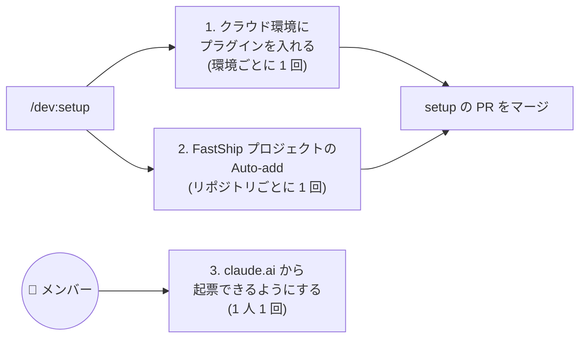

# 🖐️ 手で行う設定

`/dev:setup` が API で設定できない 3 つです。スクショの赤枠を順に押してください。



## 1. クラウド環境にプラグインを入れる
ルーティンは claude.ai のクラウド環境で動きます。環境に FastShip プラグインを入れます。

1. https://claude.ai/code を開き、入力欄の下の環境名 → **クラウド** → ルーティンの環境 (setup が名前を伝えます) の ⚙️ を押します。


2. **セットアップスクリプト** に下を貼り、**変更を保存** を押します。

<!-- setup の 4.3 と同じ。変えるときは両方を直す -->
```bash
{
  claude plugin marketplace add anthropics/claude-plugins-official &&
  claude plugin marketplace add theindiehacker/fastship-plugin &&
  claude plugin install dev@fastship
} || echo "⚠️ dev@fastship を入れられませんでした" >&2
```


## 2. FastShip プロジェクトの Auto-add
claude ラベルの付いた Issue / PR が、FastShip プロジェクトに自動で載るようにします。

1. setup が伝える URL (`https://github.com/orgs/<owner>/projects/<番号>/workflows`) を開き、**Auto-add to project** の **…** → **Duplicate workflow** を押します。
   - そのプロジェクトで 1 つ目のリポジトリなら、Duplicate せずに **Auto-add to project** を開いて右上の **Edit** を押し、3 に進みます。


2. 名前 (例: `Auto-add: <リポジトリ名>`) を入れて **Duplicate** を押します。


3. **Filters** の左のボタンを押し、対象リポジトリを選びます。


4. **Filters** の右の欄を消して下を貼り、**Save and turn on workflow** を押します。

```text
is:issue,pr label:"claude:analysis","claude:analyzed","claude:refine","claude:implement","claude:under-review","claude:approved","claude:blocked","claude:shipped"
```


5. **On** になれば完了です。


Auto-add の数には、GitHub のプランごとに上限があります (Free 1 / Pro・Team 5 / Enterprise 20)。

## 3. claude.ai から起票できるようにする
claude.ai のチャットで `/dev:issue` を使うための設定です。メンバーそれぞれが行います。

1. https://claude.ai/customize/plugins で **追加** → **マーケットプレイスを追加** を押し、`theindiehacker/fastship-plugin` を入れます。


2. `dev` を有効にします。依存の `security-guidance` も有効にします (無いと `dev` が読み込まれません)。一覧に無ければ、同じ手順で `anthropics/claude-plugins-official` を追加します。
3. **コネクタ** タブで GitHub を有効にし、起票先のリポジトリが見えるようにします。
