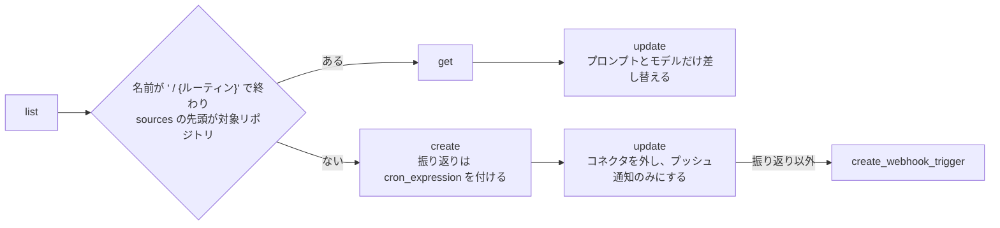
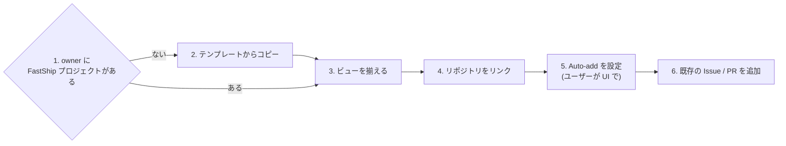

# セットアップ手順
## 1. ボイラープレートの導入
Organization のテンプレートリポジトリを対象リポジトリに導入してください。複数あればユーザーに確認し、無ければスキップしてください。

続けて `/stack:setup` で、技術スタック (bun / Biome・uv / Ruff / Pyright・lefthook) の設定を入れてください。テンプレートで入ったものは残し、足りないものだけを足します。

## 2. FastShip プラグインの設定 (ローカル)
対象リポジトリの `.claude/settings.json` に次をマージしてください。他のキーは残してください。

```json
{
  "extraKnownMarketplaces": {
    "fastship": {
      "source": {"source": "github", "repo": "theindiehacker/fastship-plugin"}
    }
  },
  "enabledPlugins": {
    "dev@fastship": true
  }
}
```

## 3. Issue / PR テンプレートの配置
FastShip プラグインのテンプレートを、対象リポジトリにコピーしてください。2 の設定と一緒にコミットします。コピーは GitHub の UI で Issue / PR を作るときに使われます。スキルはプラグインのテンプレートを直接読みます。

| コピー元 | コピー先 | 使う工程 |
|:--|:--|:--|
| `${CLAUDE_PLUGIN_ROOT}/skills/issue/backlog.md` | `.github/ISSUE_TEMPLATE/backlog.md` | ① 起票 / ③ 課題分析 |
| `${CLAUDE_PLUGIN_ROOT}/templates/ISSUE_TEMPLATE/todo.md` | `.github/ISSUE_TEMPLATE/todo.md` | ⑥ リファインメント (Sub Issue) |
| `${CLAUDE_PLUGIN_ROOT}/templates/PULL_REQUEST_TEMPLATE.md` | `.github/PULL_REQUEST_TEMPLATE.md` | ⑧ PR 作成 |

 - コピー先が無い場合は作成してください。大文字・小文字だけが違うファイル (例: `pull_request_template.md`) は同じファイルとして扱ってください。
 - 既にあって内容が違う場合は、リポジトリでカスタマイズしている可能性があります。差分を見せて、上書きしてよいかユーザーに確認してください。上書きしない場合はそのまま残してください。
 - それ以外のテンプレートは残してください。
 - 対象リポジトリに `.github/ISSUE_TEMPLATE/` が無い場合、コピーすると org の `<owner>/.github` にある Issue テンプレートと `config.yml` が使われなくなります。org にそれらがあればユーザーに伝え、対象リポジトリにもコピーするか確認してください。

## 4. ラベル駆動開発のセットアップ
リポジトリへのコミットは伴いません。

### 4.1 ラベル

```bash
gh label create claude:analysis --color d97757 --description "🤔 課題分析を始める" --force -R {owner/repo}
gh label create claude:refine --color d97757 --description "✂️ 課題分析の結果を承認し、リファインメントを始める" --force -R {owner/repo}
gh label create claude:implement --color d97757 --description "🧑‍💻 Sub Issue の実装を始める" --force -R {owner/repo}
gh label create claude:under-review --color d97757 --description "✔️ PR のレビューを始める" --force -R {owner/repo}
gh label create claude:approved --color 0e8a16 --description "✅ レビューを通った" --force -R {owner/repo}
gh label create claude:blocked --color b60205 --description "❓ 人間の回答を待っている" --force -R {owner/repo}
gh label create claude:retrospective --color d97757 --description "♻️ 振り返りの結果" --force -R {owner/repo}
gh label create claude:analyzed --color 0e8a16 --description "🧑‍💻 課題分析が終わり、承認を待っている" --force -R {owner/repo}
gh label create claude:shipped --color 0e8a16 --description "🎯 Sub Issue がすべて閉じ、成功指標の確認を待っている" --force -R {owner/repo}
```

`claude:approved` / `claude:retrospective` / `claude:analyzed` / `claude:shipped` は、人が見るためのラベルです。4.2 のトリガーには使いません。

### 4.2 ルーティン
RemoteTrigger ツールで次のルーティンをそれぞれ用意し、URL (`https://claude.ai/code/routines/{ID}`) をユーザーに伝えてください。

| ルーティン | 名前 | トリガー |
|:--|:--|:--|
| 課題分析 | `{リポジトリ名} / 課題分析` | `issues.labeled` で、Issue のラベルに `claude:analysis` を含む場合 |
| リファインメント | `{リポジトリ名} / リファインメント` | `issues.labeled` で、Issue のラベルに `claude:refine` を含む場合。`issues.closed` で、Issue のラベルに `claude:implement` を含む場合。closed は、Sub Issue が閉じたときに後続の Sub Issue に着手するのに使う |
| 実装 | `{リポジトリ名} / 実装` | `issues.labeled` / `pull_request.labeled` で、Issue / PR のラベルに `claude:implement` を含む場合。PR は、PR で止めたときの再開に使う |
| レビュー | `{リポジトリ名} / レビュー` | `pull_request.labeled` で、PR のラベルに `claude:under-review` を含む場合。実装は push を終えてからこのラベルを付けるため、`opened` / `synchronize` は使わない |
| 振り返り | `{リポジトリ名} / 振り返り` | cron で毎週月曜 8:37 (JST)。`cron_expression` は UTC で `37 23 * * 0` |

どのルーティンも次の設定にしてください。

| 項目 | 値 |
|:--|:--|
| リポジトリ | 対象リポジトリのみ |
| 環境 | 既存の ` / 課題分析` / ` / リファインメント` / ` / 実装` / ` / レビュー` / ` / 振り返り` ルーティンと同じ (無ければユーザーに確認) |
| モデル | `claude-opus-5-5` |
| コネクタ | なし |
| 通知 | プッシュ通知のみ |
| プロンプト | 下記 |

課題分析:

```text
Issue の課題分析を /dev:analysis で行ってください。
```

リファインメント:

```text
Issue のリファインメントを /dev:refine で行ってください。
```

実装:

```text
Issue / PR の実装を /dev:implement で行ってください。
```

レビュー:

```text
PR のレビューを /dev:review で行ってください。
```

振り返り:

```text
直近の開発の振り返りを /dev:retrospective で行ってください。
```



 - 既存の `update`: `get` した `job_config` を丸ごと送り、`ccr.events[0].data.message.content` と `ccr.session_context.model` だけを変える。トリガーは API から見えず重複に気づけないため、追加しない。0.3.0 以前に作った実装のルーティンには PR のトリガーが無いので、https://claude.ai/code/routines で確認し、無ければ手動で追加するよう案内する
 - `create`: `/schedule` スキルの書き方に従う。`run_once_at` は付けない。`cron_expression` は振り返りだけに付ける。実装は PR を作るので、`session_context` に `"autofix_on_pr_create": true` を付ける
 - 新規の `update`: `{"clear_mcp_connections": true, "notifications": {"channel": {"email": false, "push": true, "slack": false}}}` を送る (`create` は接続済みのコネクタをすべて付けるため)
 - `create_webhook_trigger`: 下記の body を、`{ラベル}` をトリガーのラベルに置き換えて送る。実装は PR 用に、`events` を `["pull_request.labeled"]`、`field` を `pull_request.labels` に変えた body も送る。レビューは `events` を `["pull_request.labeled"]`、`field` を `pull_request.labels`、`{ラベル}` を `claude:under-review` にした body だけを送る。リファインメントは Sub Issue の完了用に、`events` を `["issues.closed"]`、`{ラベル}` を `claude:implement` にした body も送る (実装は Sub Issue の `claude:implement` を閉じるまで外さないため、Sub Issue だけに絞れる)。振り返りは cron で動くため送らない
 - RemoteTrigger や Claude GitHub App が使えない場合は、上の表の内容で https://claude.ai/code/routines から手動で作るよう案内する

```json
{
  "routine_trigger_id": "{作成したルーティンの ID}",
  "source": "github",
  "hook_type": "app",
  "scope_id": "{owner/repo}",
  "events": ["issues.labeled"],
  "filter": {"clauses": [{"field": "issue.labels", "op": "FILTER_OP_IN", "values": ["{ラベル}"]}]}
}
```

### 4.3 クラウド環境
クラウドセッションは 2 の設定を読まないため、4.2 の環境の Setup script (claude.ai の環境設定画面) に次を追加するよう案内してください。

```bash
{
  claude plugin marketplace add anthropics/claude-plugins-official &&
  claude plugin marketplace add theindiehacker/fastship-plugin &&
  claude plugin install dev@fastship
} || echo "⚠️ dev@fastship を入れられませんでした" >&2
```

 - 1 行目は依存 (`security-guidance`・`context7`・`pyright-lsp`) のためです。無いと `dev` が読み込まれません。`stack` は同じマーケットプレイスにあるため、`dev` と一緒に入ります
 - Setup script は 0 以外で終わるとセッションが始まらないため、失敗しても警告だけ出します

### 4.4 FastShip プロジェクト
対象リポジトリを、owner の FastShip プロジェクト (GitHub Project) につなぎます。開発者は、プロジェクトのビューで次に判断することを確かめます。テンプレートは https://github.com/orgs/theindiehacker/projects/6 です。



 - 4.4 は GraphQL と、owner の Projects の API を使います。下のコマンドが失敗したら (claude.ai/code では 403 になります)、4.4 は行わず、README の「setup を使わずにつなぐ」を案内してください。その際、owner に `FastShip プロジェクト` が既にあるかを先に確かめるよう伝えてください。重複して作らないためです。

```bash
gh api graphql -f query='{ viewer { login } }' --jq .data.viewer.login
```

 - `gh auth status` の Token scopes に `project` が無ければ、`! gh auth refresh -s project` を実行するよう案内してください。
 - コマンドの `<owner>` は対象リポジトリの owner、`<n>` はプロジェクトの番号です。`<kind>` は、owner が org なら `orgs`、ユーザーなら `users` です (`gh api users/<owner> --jq .type` が `Organization` なら org)。ユーザーのビューを作る API は、ドキュメントではパスが数値の user_id ですが、login で動き、user_id では 404 になることを確かめています。

1. owner のプロジェクトから、タイトルが `FastShip プロジェクト` で、テンプレートではないものを探してください。`query` で絞らないのは、絞ると closed のプロジェクトが出ないためです。
   - 1 つなら、それを使います。`closed=true` なら、再開してよいかユーザーに確認し、`gh project close <n> --owner <owner> --undo` で再開してください。
   - 複数あれば、どれを使うかユーザーに確認してください。
   - 何も出なければ、2 でコピーします。コマンドがエラーになったときは、無いとはみなさずに止めてください。重複して作らないためです。

```bash
gh api graphql --paginate -f login=<owner> -f query='query($login: String!, $endCursor: String) { repositoryOwner(login: $login) { ... on ProjectV2Owner { projectsV2(first: 100, after: $endCursor) { pageInfo { hasNextPage endCursor } nodes { number title template closed url } } } } }' \
  --jq '.data.repositoryOwner.projectsV2.nodes[] | select(.title == "FastShip プロジェクト" and (.template | not)) | "\(.number) closed=\(.closed) \(.url)"'
```

2. テンプレートをコピーしてください。ビューと組み込みのワークフロー (Auto-add を除く) が入り、private になります。失敗したら、README の「📋 FastShip プロジェクト」にある手動の手順を案内して、4.4 を終えてください。

```bash
gh project copy 6 --source-owner theindiehacker --target-owner <owner> --title "FastShip プロジェクト" --format json --jq '"\(.number) \(.url)"'
```

3. 下の表のビューがあるかを、名前とフィルタで確かめてください (下の 1 つ目のコマンド)。
   - 無いビューだけ作ってください (3 つ目のコマンド)。`visible_fields` には列の id を入れます。id は 2 つ目のコマンドで、列の名前から引いてください。
   - 同じ名前でフィルタが違えば作らず、UI で直すようユーザーに伝えてください。ビューは API で更新・削除できず、作ると重複が残るためです。

| ビュー | フィルタ | 列 |
|:--|:--|:--|
| `④ 承認待ち` | `is:issue is:open label:"claude:analyzed"` | Title / Repository / Labels |
| `❓ 回答待ち` | `is:open label:"claude:blocked"` | Title / Repository / Labels / Parent issue |
| `⑪ マージ待ち` | `is:pr is:open label:"claude:approved" -label:"claude:blocked" -label:"claude:under-review"` | Title / Repository / Labels |
| `⑫ 成功指標の確認待ち` | `is:issue is:open label:"claude:shipped"` | Title / Repository / Labels / Sub-issues progress |

```bash
gh api graphql -f login=<owner> -F n=<n> -f query='query($login: String!, $n: Int!) { repositoryOwner(login: $login) { ... on ProjectV2Owner { projectV2(number: $n) { views(first: 50) { nodes { name filter } } } } } }' \
  --jq '.data.repositoryOwner.projectV2.views.nodes[] | "\(.name) [\(.filter)]"'
gh api --paginate "<kind>/<owner>/projectsV2/<n>/fields?per_page=100" --jq '.[] | "\(.id) \(.name)"'
jq -n --arg name "<ビュー>" --arg filter '<フィルタ>' '{name:$name, layout:"table", filter:$filter, visible_fields:[<列の id>]}' \
  | gh api --method POST "<kind>/<owner>/projectsV2/<n>/views" --input - --jq .number
```

4. リポジトリをリンクしてください。リポジトリの Projects タブに出るようになります。リンク済みでも問題ありません。

```bash
gh project link <n> --owner <owner> --repo {owner/repo}
```

5. Auto-add workflow は API で作れないため、ユーザーに UI で設定してもらい、終わったと答えてもらってください。下のラベルが付いた Issue / PR が、プロジェクトに自動で入るようになります。
   - URL: `https://github.com/<kind>/<owner>/projects/<n>/workflows`
   - 「Auto-add to project」を開いて Edit を押す。2 つ目以降のリポジトリは、既存の Auto-add のメニューから Duplicate して増やす
   - Repository: 対象リポジトリ
   - Filters: `is:issue,pr label:"claude:analysis","claude:analyzed","claude:refine","claude:implement","claude:under-review","claude:approved","claude:blocked","claude:shipped"`
   - Save and turn on workflow を押す
   - Auto-add workflow はリポジトリごとに 1 つ要り、数にはプランごとの上限があります (Free 1 / Pro・Team 5 / Enterprise 20)。リンク済みのリポジトリ (下のコマンド) が上限より多ければ、ユーザーに伝えてください。

```bash
gh api graphql -f login=<owner> -F n=<n> -f query='query($login: String!, $n: Int!) { repositoryOwner(login: $login) { ... on ProjectV2Owner { projectV2(number: $n) { repositories(first: 100) { totalCount nodes { nameWithOwner } } } } } }' \
  --jq '.data.repositoryOwner.projectV2.repositories | "\(.totalCount): \([.nodes[].nameWithOwner] | join(" "))"'
```

6. 5 が終わったら、claude ラベルが付いた open の Issue / PR を追加してください。Auto-add は、有効にする前からある Issue / PR を入れないためです。5 より先に行うと、間にラベルが付いたものが漏れます。何度実行しても重複しません。プロジェクトの一覧に出るまで、1〜2 分かかることがあります。

```bash
gh api --paginate "repos/{owner/repo}/issues?state=open&per_page=100" \
  --jq '.[] | select([.labels[].name] | any(startswith("claude:") and . != "claude:retrospective")) | .html_url' \
  | while read -r url; do gh project item-add <n> --owner <owner> --url "$url" > /dev/null; done
```

7. プロジェクトの URL をユーザーに伝えてください。
