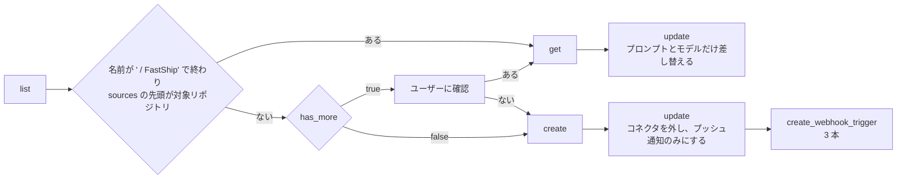

# セットアップ手順
## 1. 技術スタック (stack プラグインが入っているときだけ)
`/stack:setup` スキルが使えなければ (stack プラグインが入っていなければ)、1 は飛ばしてください。dev は技術スタックに依存しません。

使えるなら、次を行うかをユーザーに聞いてください。技術スタックはリポジトリごとに違うため、勧めずに聞くだけにします。行わないと答えたものは飛ばします。

 - ボイラープレート: Organization のテンプレートリポジトリ (`gh repo list <owner> --limit 1000 --json name,isTemplate --jq '.[] | select(.isTemplate) | .name'`) を対象リポジトリに導入する。無ければ聞きません
 - 技術スタック: `/stack:setup` で、bun / Biome・uv / Ruff / Pyright・lefthook の設定を入れる。ボイラープレートで入ったものは残し、足りないものだけを足します

`/stack:setup` を行ったら、2 の `enabledPlugins` に `"stack@fastship": true` も足してください。stack の hook (整形・lint・型チェック) が、このリポジトリで動くようになります。

## 2. FastShip プラグインの設定 (ローカル)
対象リポジトリの `.claude/settings.json` に次をマージしてください。他のキーは残してください。

```json
{
  "extraKnownMarketplaces": {
    "fastship": {
      "source": { "source": "github", "repo": "theindiehacker/fastship-plugin" }
    }
  },
  "enabledPlugins": {
    "dev@fastship": true
  }
}
```

## 3. Issue / PR テンプレートの配置
FastShip プラグインのテンプレートを、対象リポジトリにコピーしてください。2 の設定と一緒にコミットします。コピーは GitHub の UI で Issue / PR を作るときに使われます。スキルはプラグインのテンプレートを直接読みます。

| コピー元 | コピー先 | 使う工程 |
|:--|:--|:--|
| `${CLAUDE_PLUGIN_ROOT}/skills/issue/backlog.md` | `.github/ISSUE_TEMPLATE/backlog.md` | ① 起票 / ③ 課題分析 |
| `${CLAUDE_PLUGIN_ROOT}/templates/ISSUE_TEMPLATE/todo.md` | `.github/ISSUE_TEMPLATE/todo.md` | ⑥ リファインメント (Sub Issue) |
| `${CLAUDE_PLUGIN_ROOT}/templates/PULL_REQUEST_TEMPLATE.md` | `.github/PULL_REQUEST_TEMPLATE.md` | ⑧ PR 作成 |

 - コピー先が無い場合は作成してください。大文字・小文字だけが違うファイル (例: `pull_request_template.md`) は同じファイルとして扱ってください。
 - 既にあって内容が違う場合は、リポジトリでカスタマイズしている可能性があります。差分を見せて、上書きしてよいかユーザーに確認してください。上書きしない場合はそのまま残してください。
 - それ以外のテンプレートは残してください。
 - 対象リポジトリに `.github/ISSUE_TEMPLATE/` が無い場合、コピーすると org の `<owner>/.github` にある Issue テンプレートと `config.yml` が使われなくなります。org にそれらがあればユーザーに伝え、対象リポジトリにもコピーするか確認してください。

## 4. ラベル駆動開発のセットアップ
リポジトリへのコミットは伴いません。

### 4.1 ラベル

```bash
gh label create claude:analysis --color d97757 --description "🤔 課題分析を始める" --force -R {owner/repo}
gh label create claude:refine --color d97757 --description "✂️ 課題分析の結果を承認し、リファインメントを始める" --force -R {owner/repo}
gh label create claude:implement --color d97757 --description "🧑‍💻 Sub Issue (1 PR で済むときは Issue) の実装を始める" --force -R {owner/repo}
gh label create claude:under-review --color d97757 --description "✔️ PR のレビューを始める" --force -R {owner/repo}
gh label create claude:blocked --color b60205 --description "❓ 人間の回答を待っている" --force -R {owner/repo}
gh label create claude:analyzed --color 0e8a16 --description "🧑‍💻 課題分析が終わり、承認を待っている" --force -R {owner/repo}
```

`claude:analyzed` は、人が見るためのラベルです。4.2 のトリガーには使いません。レビューが ✅ になった PR は、ラベルではなく、Ready で `claude:under-review` が付いていないことで示します。

### 4.2 ルーティン
RemoteTrigger ツールで、FastShip のルーティンを 1 つ用意し、URL (`https://claude.ai/code/routines/{ID}`) をユーザーに伝えてください。課題分析・リファインメント・実装・レビューは、1 つのルーティンが Issue / PR のラベルを見て選びます。

| 項目 | 値 |
|:--|:--|
| 名前 | `{リポジトリ名} / FastShip` |
| リポジトリ | 対象リポジトリのみ |
| 環境 | 既存の ` / FastShip` ルーティンと同じ。無ければユーザーに確認 |
| モデル | `claude-opus-5-5` |
| ツール | claude.ai の既定 (`session_context.allowed_tools` を `["preset:default"]` にする) |
| コネクタ | なし |
| 通知 | プッシュ通知のみ |
| プロンプト | 下記 |

トリガーは次の 3 本です。

| イベント | ラベル (どれかを含む場合) | 使う工程 |
|:--|:--|:--|
| `issues.labeled` | `claude:analysis` / `claude:refine` / `claude:implement` | 課題分析・リファインメント・実装 |
| `issues.closed` | `claude:implement` | リファインメント (Sub Issue が閉じたときに、後続の Sub Issue に着手する。1 PR で済むとしてそのまま実装した Issue が閉じたときも起動するが、何もせずに終わる) |
| `pull_request.labeled` | `claude:implement` / `claude:under-review` | 実装 (PR で止めたときの再開)・レビュー。実装は push を終えてから `claude:under-review` を付けるため、`opened` / `synchronize` は使わない。Draft の PR では起動しないため、実装は PR を Ready にしてからラベルを付ける |

プロンプト:

```text
GitHub のイベントで起動しました。トリガーになった Issue / PR に、FastShip の工程を 1 つ行ってください。
1. Issue (PR ではない) が closed なら、/dev:refine で行ってください。Sub Issue が閉じたときの後続の着手です。
2. それ以外は、Issue / PR に付いているラベルを見て、次の順に試してください。スキルの「1. 始める」で STOP と出たら、次を試してください。どれも STOP か、ラベルが無ければ、何もせずに終えてください。
   - claude:under-review → /dev:review
   - claude:implement → /dev:implement
   - claude:refine → /dev:refine
   - claude:analysis → /dev:analysis
```

 - 工程は、イベントの種類ではなく Issue / PR の状態とラベルで選びます。セッションに渡るイベントの内容は、ルーティンのドキュメントに書かれていないためです。`issues.closed` で起動するのは closed の Issue だけなので、状態で見分けられます。
 - 「1. 始める」(`blocked.sh start`) は、ラベルが付いた後にまだ着手していなければ `CONTINUE`、それ以外は何も変えずに `STOP` を返します。このため、付いたばかりのラベルの工程だけが動きます (例: `claude:implement` と `claude:under-review` が付いた PR に `claude:under-review` を付け直すと、実装は着手済みで `STOP` になり、レビューが動く)。



 - `list`: 返るのは 20 件までで、続きは取れない (`next_cursor` を渡しても同じページが返る)。`has_more` が true のときに見つからないルーティンは、無いとみなさない (重複して作らないため)。https://claude.ai/code/routines に `{リポジトリ名} / FastShip` があるかユーザーに確認し、あれば URL の `trig_…` で `get` する。無ければ `create` する
 - 既存の `update`: `get` した `job_config` を丸ごと送り、`ccr.events[0].data.message.content` と `ccr.session_context.model` だけを変える。トリガーは API から見えず重複に気づけないため、追加しない
 - `create`: `/schedule` スキルの書き方に従う。`run_once_at` と `cron_expression` は付けない。実装は PR を作るので、`session_context` に `"autofix_on_pr_create": true` を付ける。課題分析・レビューは PR を作らないため、付いていても何も起きない。リファインメントは epic ブランチの PR を作るが、作った後に購読を外す
 - 新規の `update`: `{"clear_mcp_connections": true, "notifications": {"channel": {"email": false, "push": true, "slack": false}}}` を送る (`create` は接続済みのコネクタをすべて付けるため)
 - `create_webhook_trigger`: 上のトリガーの表の行ごとに、下記の body を、`events` をその行のイベントに、`values` をその行のラベルに置き換えて送る。`pull_request.labeled` は `field` を `pr.labels` にする。`pull_request.labels` は `unknown field` で拒否される
 - RemoteTrigger や Claude GitHub App が使えない場合は、上の表の内容で https://claude.ai/code/routines から手動で作るよう案内する

ルーティンの URL と一緒に、次の前提をユーザーに伝えてください (README の「🛟 ルーティンの前提」)。
 - ルーティンは、作った人の claude.ai アカウントに属し、チームでは共有されない。作った人の利用枠を使い、その人が抜けると止まる。そのときは、別の人が `/dev:setup` を実行し直して作り直す
 - `issues.labeled`・`issues.closed` のトリガーは、ルーティンのドキュメントに無い (載っている GitHub イベントは Pull request と Release だけ)
 - GitHub イベントは、ルーティンごと・アカウントごとの毎時の上限を超えると捨てられる (上限の数値は公開されていない)。ルーティンが 1 つなので、すべての工程で 1 つの上限を分け合う
 - 動かなかった・途中で止まった Issue / PR は、進行中のラベルが付いたまま 4.4 の `⏳ 進行中` に残る。10 分以上進まないものは、ラベルを外して付け直す

```json
{
  "routine_trigger_id": "{作成したルーティンの ID}",
  "source": "github",
  "hook_type": "app",
  "scope_id": "{owner/repo}",
  "events": ["issues.labeled"],
  "filter": {"clauses": [{"field": "issue.labels", "op": "FILTER_OP_IN", "values": ["claude:analysis", "claude:refine", "claude:implement"]}]}
}
```

### 4.3 クラウド環境
クラウドセッションは 2 の設定を読まないため、4.2 の環境の Setup script (claude.ai の環境設定画面) に次を追加するよう案内してください。環境の名前と、スクショ付きの手順 https://github.com/theindiehacker/fastship-plugin#3-クラウド環境 を伝えます。README にも同じスクリプトがあるため、変えるときは両方を直してください。

```bash
{
  claude plugin marketplace add anthropics/claude-plugins-official &&
  claude plugin marketplace add theindiehacker/fastship-plugin &&
  claude plugin install dev@fastship
} || echo "⚠️ dev@fastship を入れられませんでした" >&2
```

 - 1 行目は依存 (`security-guidance`。stack なら `context7`・`pyright-lsp` も) のためです。無いと `dev` が読み込まれません
 - Setup script は 0 以外で終わるとセッションが始まらないため、失敗しても警告だけ出します
 - 1 で `/stack:setup` を行ったら、次の行も足すよう案内してください。stack は dev と一緒には入りません。環境は他のリポジトリと共有しますが、stack の hook は道具と設定 (`mise.toml`・lock ファイル・`node_modules` の Biome・`.venv` の Ruff など) が無いリポジトリでは何もしません

```bash
claude plugin install stack@fastship || echo "⚠️ stack@fastship を入れられませんでした" >&2
```

4.2 で既存のルーティンを `update` した (導入済みの) ときは、上のスクリプトは入っているはずです。追加は案内せず、README の https://github.com/theindiehacker/fastship-plugin#版を上げたとき を読むよう伝えてください。版ごとの手順と、クラウド環境を作り直すかが書いてあります。クラウド環境は Setup script の結果を約 7 日使い回すため、作り直さなくても、ルーティンは 7 日以内に新しい版に入れ替わります。

### 4.4 判断待ちの一覧
開発者は、リポジトリの Issue 一覧を下のクエリで絞って、次に判断することを確かめます。工程はラベルと PR の Draft / Ready で決まるため、GitHub Project は使いません。

下の表の一覧ごとに、下のコマンドでリンクを作り、一覧の名前と一緒にユーザーに伝えてください。ブックマークするよう伝えます。リポジトリの Issue 一覧は、Issue と PR を一緒に出します。`<デフォルトブランチ>` は、対象リポジトリのデフォルトブランチに置き換えてください。epic ブランチに向けた Sub Issue の PR は実装がマージするため、`⑪ マージ待ち` に出さないためです。

| 一覧 | クエリ |
|:--|:--|
| `④ 承認待ち` | `is:issue is:open label:"claude:analyzed"` |
| `❓ 回答待ち` | `is:open label:"claude:blocked"` |
| `⑪ マージ待ち` | `is:pr is:open draft:false base:<デフォルトブランチ> -label:"claude:blocked" -label:"claude:under-review"` |
| `⏳ 進行中` | `is:open label:"claude:analysis","claude:refine","claude:implement","claude:under-review" -label:"claude:blocked"` |

```bash
jq -rn --arg q '<クエリ>' '"https://github.com/{owner/repo}/issues?q=\($q | @uri)"'
```

## 5. Actions の Claude レビュー
FastShip の PR は ⑨ がレビューします。PR のイベントで Actions の Claude レビュー (claude-code-action) が自動で動くと、レビューが二重になり、GitHub Actions の時間も使います。FastShip の Claude の作業はルーティン (サブスク) で動かすため、Actions の Claude は人が頼んだときだけ動くようにします。

1. claude-code-action を使うワークフローを探してください。他のワークフローを `uses:` で呼ぶもの (reusable workflow) は、呼び先も確かめてください。

```bash
grep -rlE 'anthropics/claude-code(-base)?-action' .github/workflows/
```

2. 見つかったワークフローの `on:` から、人が頼まなくても動くトリガーを洗い出してください。
   - PR のイベント (`pull_request` / `pull_request_target`)。`types` の `opened`・`ready_for_review`・`synchronize`・`reopened`・`labeled` など、どれもまとめて確かめます。`types` が無ければ `opened`・`synchronize`・`reopened` で動きます。
   - コメント・レビューのイベント (`issue_comment` / `pull_request_review_comment` / `pull_request_review`) のうち、`if:` で本文 (`/code-review`・`@claude` など) を絞っていないもの。⑨ のレビューや実装の返信でも動きます。
3. 2 で出たら、ワークフローとトリガーを見せ、⑨ と二重になり Actions の時間を使うことを伝えて、自動の起動を止めるか確認してください。
   - 止めるなら、PR のイベントを `on:` から外してください。本文を絞っていないコメントのトリガーは、`if:` で本文を絞ってください。コメントでの依頼 (`/code-review` など) は残します。
   - `on:` に何も残らなければ、ワークフローを消すか確認してください。
   - 止めないと答えたら残し、FastShip の PR でも二重に動くことを伝えてください。
   - 変えたら、2・3 と同じコミットに入れてください。
4. org の必須ワークフロー (Rulesets) に claude-code-action があれば、リポジトリからは止められません。下の 1 つ目のコマンドで必須ワークフローを出し、2 つ目で読んで 2 と同じように確かめてください。出たら、org の管理者に止めてもらうよう伝えてください。読めなければ (404 など)、ユーザーに聞いてください。

```bash
gh api "repos/{owner/repo}/rules/branches/<デフォルトブランチ>" --jq '.[] | select(.type == "workflows") | .parameters.workflows[] | "\(.repository_id) \(.path) \(.ref)"'
gh api "repositories/<repository_id>/contents/<path>?ref=<ref>" --jq .content | base64 -d
```

## 6. epic ブランチの CI
Sub Issue の PR は epic ブランチ (`epic/<親 Issue>`) に向き、実装は ⑨ の ✅ と CI の成功でマージします (`/dev:implement` の 7)。epic ブランチに向けた PR で CI が動かないと、CI を通さずにマージされます。

1. `.github/workflows/` で、`pull_request` / `pull_request_target` の `branches` が epic ブランチに当たらない (デフォルトブランチだけなど) ワークフローを探してください。`branches` が無いものと、`branches-ignore` だけのものは、epic ブランチに向けた PR でも動きます。
2. 見つかったら見せて、`branches` に `epic/**` を足すか確認してください。足すなら、2・3 と同じコミットに入れてください。
3. 5 の 4 で org の必須ワークフローが出たら、Ruleset の対象ブランチに `epic/**` が無いと、epic ブランチに向けた PR では動かないことを伝えてください。足すかは org の管理者が決めます。
